# Star Wars Jedi Knight Dark Forces II Rekindled

Star Wars Jedi Knight: Dark Forces II **Rekindled** refreshes the single-player campaign with a new progression system, rebalanced combat, and improvements for modern PCs

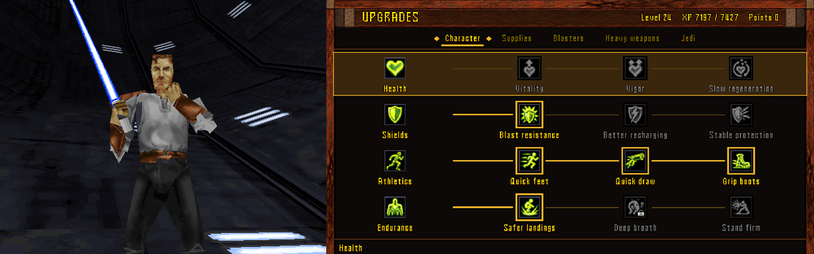

### A complete progression system designed for the full campaign

**Earn XP and upgrade your abilities, weapons, and equipment** throughout the campaign, with new choices opening as you discover gear

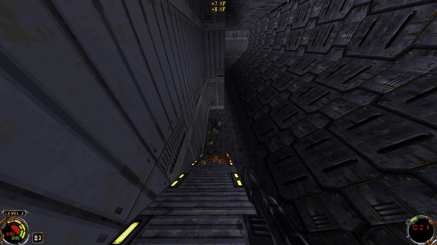

### A rebalanced campaign

**The original difficulty options have been replaced with a single rebalanced difficulty** designed to keep the campaign challenging as your abilities grow, with changes to combat, supplies, and even level layouts

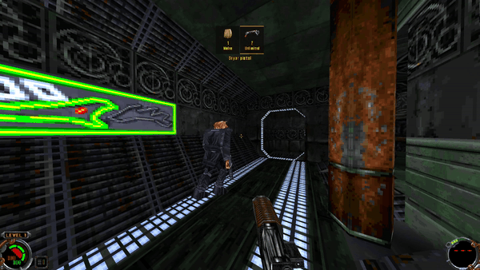

### Improved lightsaber

**Manual blocking, timed deflections, and charged heavy swings** make lightsaber combat more intuitive, with color options and an improved first-person angle

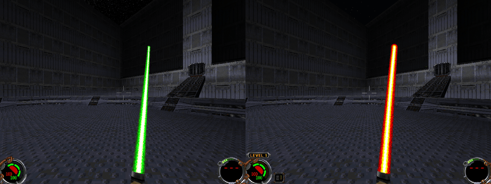

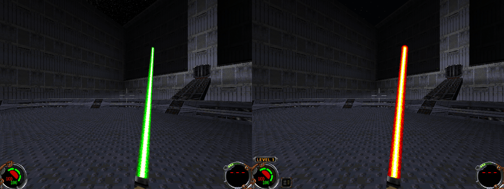

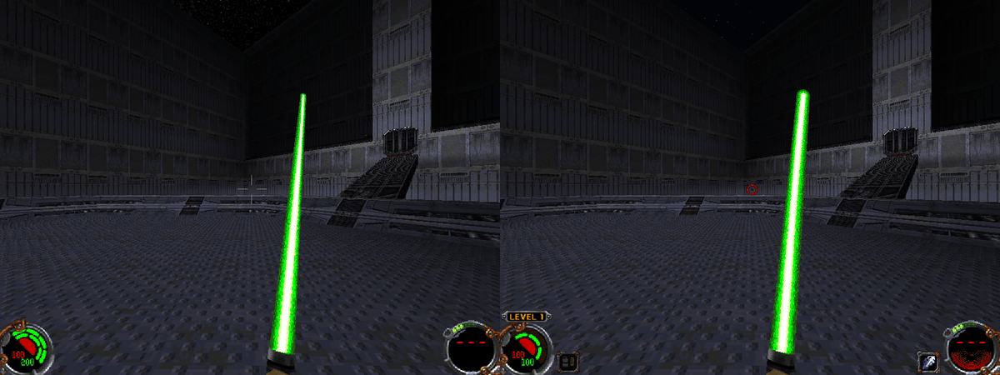

### A more populated world

**More civilians fill bars, streets, gathering spots, and workplaces, making the world feel more alive**

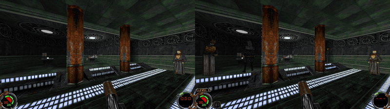

### Streamlined settings

**Crosshair styles, colors, and all your settings on one page**

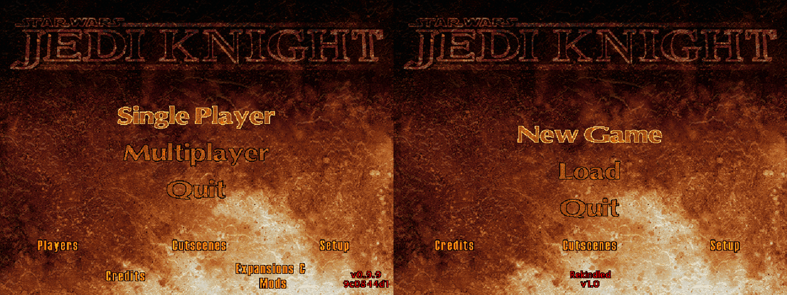

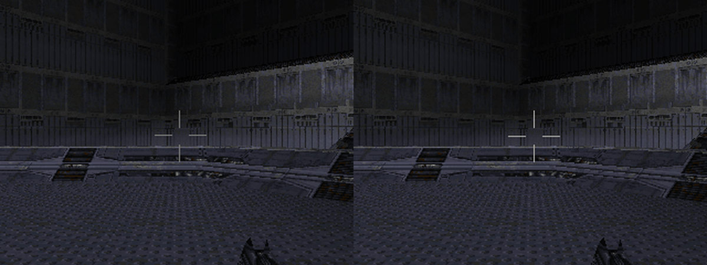

### Improved skies

**Corrected sky movement and a distant star field** replace sliding landscapes and repeating space backgrounds

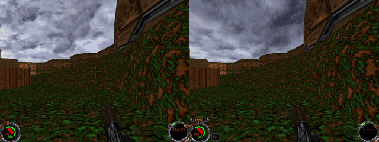

### Find the right weapon at a glance

**A brief weapon display shows selection keys and ammunition** whenever you switch weapons

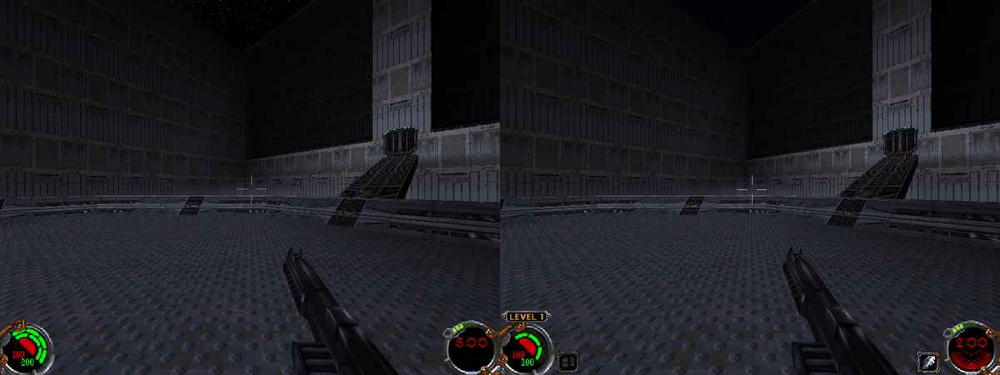

## Features

- **XP and upgrades for abilities, weapons, and equipment**

- **A single difficulty with rebalanced combat, weapons, enemies, and supplies**

- **New lightsaber combat, improved angle, and color options**

- **More civilians and varied character appearances**

- **Weapon selection and ammunition display**

- **Dedicated bacta key and Force power HUD**

- **Customizable crosshair styles, colors, and size**

- **Corrected sky movement and distant stars**

- **Streamlined settings and improved mouse controls**

- **Automatic resolution support, including 4K and ultrawide**

- **Auto-save feature, and quick loading for manual quick-saves**

- **Level fixes that prevent getting stuck**

- **Controller support for gameplay, menus, and upgrades** (full playthrough not yet tested)

## System requirements

- Windows 10 or 11, 64-bit

- **Your own copy** of Star Wars Jedi Knight: Dark Forces II

## Installation

Download the Rekindled launcher from [**Releases**](https://github.com/MaximGoesBananas/Dark-Forces-II-Rekindled/releases).

1. Open the launcher and choose your **Jedi Knight: Dark Forces II** folder. If it is not found automatically, select it with **Browse**.

2. Select **Install**, then **Play**.

Rekindled installs beside the original game, and the launcher can remove it again. Saves and settings are shared with your existing installation, so back up your saves before trying it.

## Compatibility

See the [controller guide](docs/UPGRADES.md#controller-controls) for the default layout. The sensitivity slider and Invert look setting also control the right stick.

SteamOS and Proton have not been verified.

Rekindled focuses on refreshing the single-player campaign, so **multiplayer is not supported.**

The Mysteries of the Sith expansion **is not compatible with Rekindled.**

Steam is not required by the launcher. Rekindled has been tested with Steam's game files; [OpenJKDF2 supports GOG's files](https://github.com/shinyquagsire23/OpenJKDF2#openjkdf2), but Rekindled has not yet been tested with a GOG or original disc installation.

## Credits

Built on [OpenJKDF2](https://github.com/shinyquagsire23/OpenJKDF2) and its contributors.
Jedi Knight and Star Wars belong to Lucasfilm; this is an unofficial fan project
and requires your own copy of the game.

Weapon illustrations are adapted from LucasArts' original official website. Original game archives are not included. See the [artwork credits](docs/UPGRADE-ART.md) and [included component notices](release/NOTICES.txt).

I designed and directed Rekindled from the ground up, from all of its gameplay changes to its visual details.
AI tools assisted with development and artwork.
